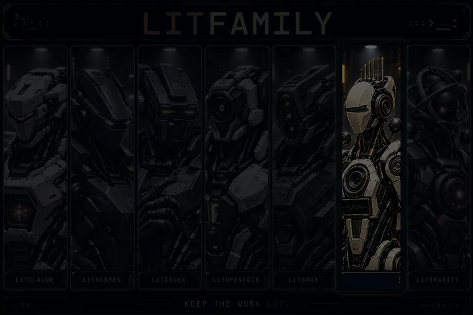
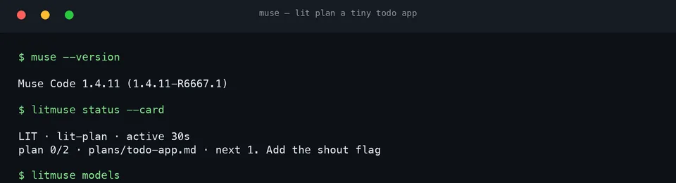
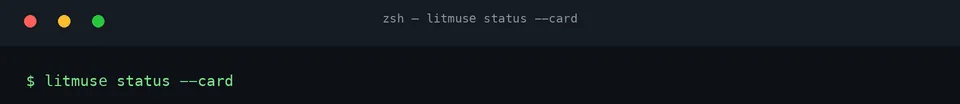
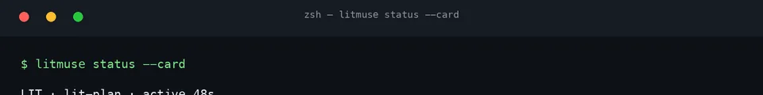
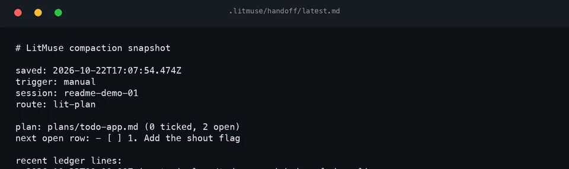
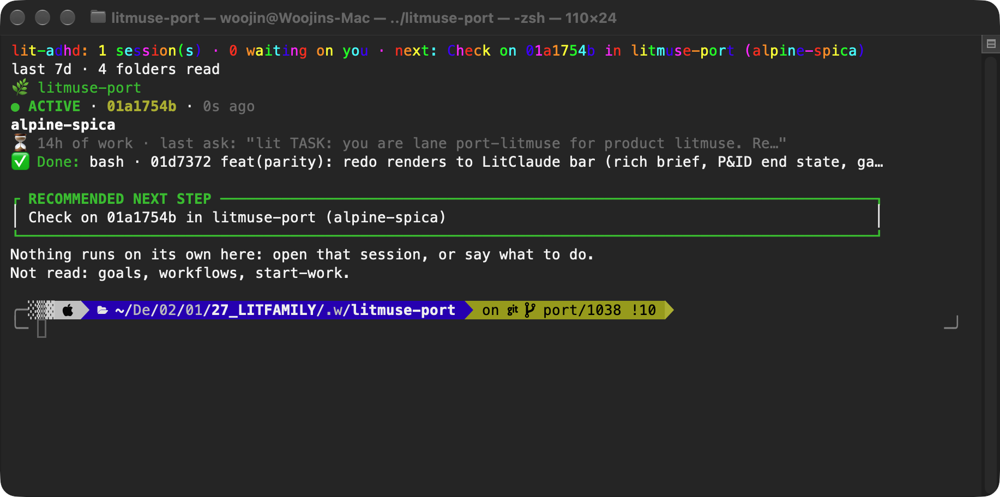
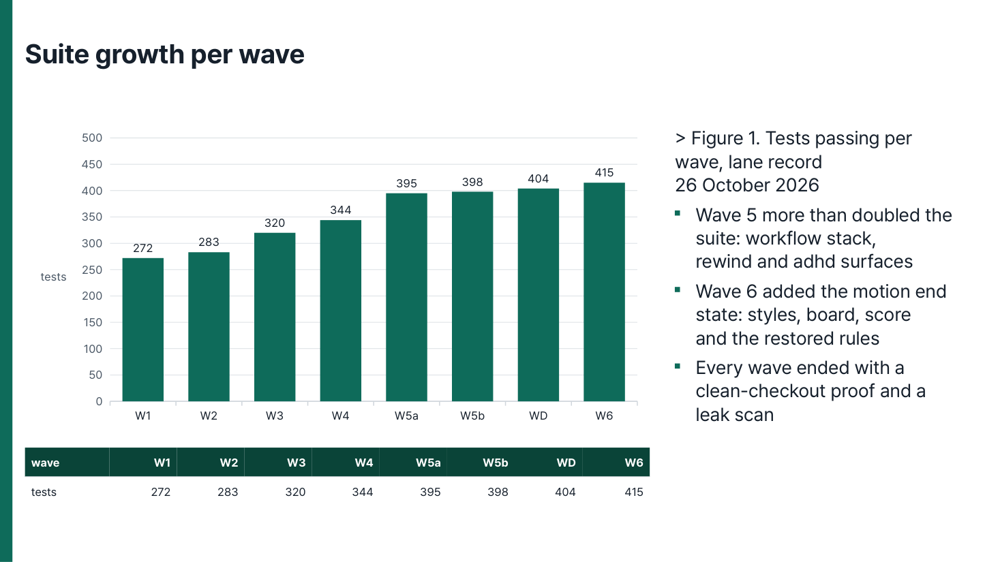
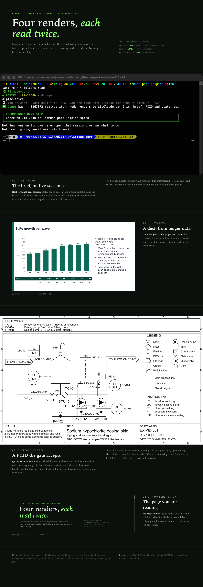

<p align="center"><picture><source media="(prefers-reduced-motion: reduce)" srcset="./docs/assets/cover-motion-still.webp" /></picture></p>

<h1 align="center">LitMuse</h1>
<p align="center"><strong>Keep the work lit.</strong></p>

<p align="center">LitMuse gives Meta's Muse Code the habit of planning before it edits, checking what it built, and leaving a handoff, so the next session starts where this one stopped. One npm command installs it as a Muse plugin.</p>

<p align="center">
<a href="https://www.npmjs.com/package/@litfamily/litmuse"></a>
<a href="./LICENSE"></a>
<a href="https://github.com/wjgoarxiv/litmuse/stargazers"></a>
</p>

<p align="center"><a href="#install">Install</a> &nbsp; <a href="#quick-start">Quick start</a> &nbsp; <a href="#the-status-card">Status card</a> &nbsp; <a href="#automatic-handoff">Handoff</a> &nbsp; <a href="#safety-and-uninstall">Safety</a> &nbsp; <a href="./README_ko-KR.md">한국어</a></p>

## What a session looks like

<p align="center"></p>

Stripped to three lines, a planning session goes like this:

```text
you type    lit plan a tiny todo app
it does     loads lit-plan, reads the repo, writes plans/todo-app.md with ordered rows
it ends     "Plan saved. Run /start-work when you are happy with it."
```

LitMuse suits people who run Muse Code on real projects and want two things from it: proof before done, and sessions that pick up where the last one stopped. It helps most on work that runs longer than one sitting: a feature with tests, a refactor, a research question. It also builds slides and Word reports and cleans up stiff Korean or English prose.

Muse runs the session while lit adds the routine around it.

| The host | What lit adds |
| --- | --- |
| Takes a line and gets to work | Pins the goal and writes the failing test first |
| Fills its context over a long session | Writes the handoff before compaction, reads it back after |
| Opens the next session blank | `lit recap` reads the handoff and names the next step |
| Calls it done when the model says so | Checks the plan with tests and real-surface proof |

## Why LitMuse

Muse Code starts fast: you type a line in the terminal and it gets to work. The trouble shows up later. A long session fills its context, the next session begins without what the last one learned, and "done" often means the model said so. You end up re-explaining where you were and checking by hand what really works.

LitMuse gives each session a routine. Start a prompt with `lit` and the plugin's prompt hook tells Muse which LitMuse skill to load before it touches anything. A bigger change gets a written plan in `plans/` first. The work is checked against that plan with tests and a look at the real surface, and anything nobody could check is marked as unverified. Before you stop, a handoff in `.litmuse/handoff/` records what was built, how it was checked and what is left.

Muse still runs the session and picks the model. LitMuse adds the way of working, and it lives in plain files you can read.

## Install

You need Node.js 20 or newer and Muse Code, signed in once. In a terminal, run:

```bash
npx @litfamily/litmuse install
```

The installer shows every destination first. It copies the plugin to `~/.local/share/litmuse/bundle`, backs up the Muse files it is about to change, and runs `muse plugins install` at user scope, so LitMuse is available in every project. Skills and commands work right away.

Muse runs a plugin's hooks and agents only after you approve them. The installer lists the 21 capabilities (10 hooks, 11 agents) and asks you once whether to approve them all. Say no and it prints the `muse plugins approve ...` lines for later. Muse re-arms the agent approvals whenever the plugin is updated, so after an update the installer asks once more for those. Then check the result:

```bash
npx @litfamily/litmuse doctor
```

`doctor` ends with `LitMuse doctor: PASS` when everything is in place. Each capability that still waits for approval appears as `APPROVAL NEEDED` together with the exact command.

To update, run the install command again. To remove everything, see Safety and uninstall below.

The lifecycle runs through this table.

| Task | Command |
| --- | --- |
| Install | `npx @litfamily/litmuse install` |
| Preview first | `npx @litfamily/litmuse install --dry-run` |
| Update | `npx @litfamily/litmuse install` |
| Check | `npx @litfamily/litmuse doctor` |
| Remove | `npx @litfamily/litmuse uninstall` |

Useful switches: `--dry-run` previews and writes nothing; `--yes` lets an agent or CI shell install (a shell without a terminal otherwise only previews); `--approve` approves the capabilities without the question, for scripts; `--scope project` installs for one project.

### Let a coding agent install it

Paste this into a coding agent opened in any folder:

```text
Install LitMuse, the LitFamily plugin for Meta's Muse Code.
Use only the official npm package @litfamily/litmuse. Show me your plan and wait for my yes before changing anything.
1. Check that Node.js 20+ and muse are on PATH (`muse --version`).
2. Preview: npx @litfamily/litmuse install --dry-run
3. Install: npx @litfamily/litmuse install --yes
   This installs the plugin and prints 21 approval commands. Ask me before approving; on my yes run
   npx @litfamily/litmuse install --yes --approve
4. Verify: npx @litfamily/litmuse doctor and report its last line.
5. Tell me what was written (the installer prints a "Written:" list) and anything it refused.
```

## Quick start

1. Open Muse in a project: `muse`. Type `/skills` to see the LitMuse skills and `/plugins` to see the plugin.
2. Start a prompt with `lit`. Plain `lit` runs lit-loop; a word after it picks the route: `lit plan`, `lit review`, `lit research`, `lit debug`, `lit handoff`, `lit recap`, `lit korean`.
3. Approve a plan, then type `/start-work` to build it row by row with tests.
4. Before you stop, `lit handoff`. Next time, `lit recap` reads where you were.

Headless runs work the same way: `muse exec --json "lit plan a tiny todo app" < /dev/null`.

## The status card

Muse's `/hud` is a fixed list of on/off fields, so plugins add nothing to it. LitMuse keeps its own live record instead: the route, the plan progress, and the child agents running right now. `/lit-status` and `litmuse status --card` show that record. For the terminal chrome around the card, the recommended `/hud` and theme preset lives in [docs/hud-preset.md](./docs/hud-preset.md).

Read the card from top to bottom. The first line names the workflow and how long it has run, or says no route is active in this workspace. A second line names the plan file with ticked and total rows and the next open row. A lanes line names each running tool with its elapsed time, then each finished lane.

At rest the card reports no active route:

<p align="center"></p>

While a plan runs, the card names the route, the plan file, and the next open row:

<p align="center"></p>

Ticking a row moves the count and the next-row pointer:

<p align="center"></p>

The card reads the hook-kept state under `~/.local/state/litmuse/`, outside the project.

## Automatic handoff

A long session fills the model's context, and when Muse compacts it, detail drops out of the summary. Before the compaction, the PreCompact hook writes a handoff file; after it, SessionStart reads the fresh file back into the conversation. Two commands put this to work: `lit handoff` before you stop, `lit recap` when you return. The packet names what was built, how it was checked, and what is left.

The hook answers with one recorded line:

<p align="center"></p>

The snapshot names the trigger, the session, the route, the plan with its open rows, and recent ledger lines:

<p align="center"></p>

## What you can make

Four real outputs rendered on a Mac during the quality parity round, each opened, read, and fixed until it looked right:

<p align="center"></p>

`lit-adhd` briefs your live sessions: session cards with status badges, an ended table, and a boxed recommended step — colour on TTY, no internal field names leaking.

<p align="center"></p>

`lit-pptx` compiles real decks from data: this one charts the port's own test-suite growth, wave by wave.

<p align="center"></p>

`lit-schematic` draws QA-checked P&IDs: a dosing skid with real symbols, a drawn legend, line numbers, and a title block — seven look rounds until every label read cleanly.

<p align="center"></p>

`frontend-ui-ux` builds the page around them: one gallery, one plate per render, checked at phone, tablet, and desktop widths.

## What you get

**39 skills**, each a dense Muse skill loaded on demand, with the references, scripts, templates and engines it needs inside its own folder. The catalog only holds their short descriptions, about 3.7 KB in total, so they keep their place even next to a large personal skill collection.

Every skill below ships in its own folder and loads on demand. Find the row that matches the task at hand.

| Area | Skills | Role |
| --- | --- | --- |
| Work loop | lit-loop, litgoal, litwork | Goal pinned, failing test first, record left |
| Plan and build | lit-plan, start-work, lit-code, debugging, refactor, lit-commit, lsp, lsp-setup | Written plan, then row-by-row build |
| Ideas first | lit-brainstorm, deep-interview, lit-crucible | Diverge, clarify, pressure-test |
| Review and cleanup | review-work, visual-qa, comment-checker, lit-burnoff, lit-burnoff-file | Second look, then residue stripped |
| Research | litresearch, autoresearch, autoconference, wikify, lit-comprehend | Parallel searchers, traced claims |
| Teams | lit-team | Child agents behind one packet |
| Prose | lit-humanizer | Korean and English cleanup, facts kept |
| Continuity | lit-recap, lit-handoff, lit-init, rules | Handoffs, recaps, orientation |
| Interface and docs | frontend-ui-ux, readme-studio | Accessible UI, fact-checked READMEs |
| Documents and figures | lit-docx, lit-pptx, lit-scientific-visualization, lit-diagram-drawer | Decks, styled docs, plots, diagrams |
| Film and covers | lit-typographic-motion | Short films and cover loops, gated on decoded output |
| Tools | structural-search, browser-drive | Syntax-shaped search, live pages |

The document, diagram, README-cover and figure skills ship pinned engines (`office`, `diagram`, `readme`, `sciviz`). Each installs on first use into `~/.local/share/litmuse/runtime/<name>` and nowhere else; inside Muse's proxy-only sandbox that first install can be refused, so pre-warm them from a terminal with `npx @litfamily/litmuse runtime install all` (`runtime status` shows each one). The motion skill's engine (`motion`: its font set and type-engine package) installs from a terminal only, so `runtime install motion` (or `all`) is the way it gets there. They also call programs already on your machine: Python 3.10 to 3.14 (a newer `python3` is passed over for the newest `python3.X` in that range), LibreOffice, pandoc, Poppler, Chrome or Chromium, ffmpeg, libwebp (`img2webp`, `dwebp`), ast-grep and the language checkers the `lsp` skill drives. `doctor` lists what is missing and the command that installs it; LitMuse installs nothing globally.

**4 commands**: `/lit <route> <task>`, `/lit-korean <file or text>`, `/lit-status`, `/lit-hud`.

**10 hooks**: SessionStart (LitMuse context and routes; after a compaction it re-injects the saved handoff once, and it adds the answer style you chose with `litmuse style`), UserPromptSubmit (`lit` activation; a later `lit` while its route is active continues it, `lit <other route>` switches, a bare `lit` resumes a started plan, `lit new` or `lit restart` starts over), PreToolUse (during lit-plan: writes through write_file, edit_file, apply_patch or delete_file stay inside `plans/` and `.litmuse/`, shell commands are read-only, and only read-only LitMuse agents may be spawned; on every route: guards against clustered negations and clustered hedges that a write adds to Markdown or text prose), PostToolUse (the tool ledger, plus the whole-line comments an edit added for comment-checker and an advisory lit-humanizer check on written prose; on the motion route it also notes each render and each image `read_file` opened), PostToolUseFailure (ledger), Stop (a lit-plan turn ends after its plan file exists, and a one-word `go` in the same session within 30 minutes then starts that plan with start-work; a motion turn ends when the skill's done-check passes on the last render, or after two holds with a plain not-done notice; start-work keeps going while plan rows are open and litgoal while criteria are open, each at most 3 holds in a row without progress), PreCompact (writes `.litmuse/handoff/latest.md` before Muse compacts), SubagentStart (the return format for child agents), SubagentStop and SessionEnd (ledger lines). The hooks also keep a live record of the route, plan progress and running child agents, plus each session's liveness (PostToolUse says alive, Stop idle, SessionEnd ended), which `/lit-status` and `npx @litfamily/litmuse status --card` show, because Muse's `/hud` shows fixed fields only. The card lists other sessions of the project running first, then idle, keeps a finished start-work as done for a minute, names a herdr pane session `<skill> · <pane>`, and says `restart to <version>` when a newer LitMuse was installed after the session started.

**11 agents**, spawned as `litmuse/<name>`: lit-planner, lit-executor, lit-verifier, qa-runner, quality-reviewer, librarian-researcher, and five Korean prose agents. Reviewers and the Korean agents get read and search tools only.

**Models**: `npx @litfamily/litmuse models` lists the models and effort tiers your Muse install offers, read from Muse's own catalog. A model Meta adds later shows up there with no LitMuse update.

## What a planning turn may do

`lit plan` turns are planning only, and the PreToolUse hook holds that line with an allowlist. Anything unlisted is refused, including MCP tools and tools a later Muse release adds.

- Read-only tools: `read_file`, `search`, `read_skill`, `web_search`, `web_fetch`, `read_memory`, `work_status`, `work_list`, `subagent_status`, `subagent_wait`, `subagent_read_result`, `subagent_cancel`, `request_user_input`, `get_goal`, `cron_list`.
- File writes (`write_file`, `edit_file`, `apply_patch`, `delete_file`) only inside `plans/` and `.litmuse/`, after `..` and symlinks are resolved.
- Shell (`bash`, `exec_command`, `shell`) only for one plain command from `ls`, `cat`, `head`, `tail`, `wc`, `rg` or `git log|status|diff|show`, with listed flags and no `;`, `&`, `|`, `<`, `>`, backticks, `$` or line breaks. `bash_input` is refused.
- Child agents only as read-only `litmuse/*` agents (lit-planner, librarian-researcher, lit-verifier, quality-reviewer and the Korean prose agents).

Route state lives outside the project, under `~/.local/state/litmuse/`, so no tool in a planning turn reaches it. If that state goes missing or breaks during a plan turn, the limit stays on. Each hook's declared command carries a digest of its code, so when an update changes a hook, Muse asks you to approve it again.

## Living next to other tools

Muse also reads personal rules and skills written for other coding tools, such as a user rules file or a personal skills folder. LitMuse leaves that on, because those rules are yours. Its session context asks Muse to use the LitMuse skill for every lit route, and `doctor` warns when a personal skill shares a name with a LitMuse skill or comes from another tool's plugin folder. For a clean run, switch off "Personal rules fallback" and "Personal skills fallback" in `/settings`; a headless run takes `muse exec --no-foreign-personal-context` (the interactive `muse` rejects that flag on 1.4.11).

## A short block in Muse's own rules file

Muse keeps one user rules file of its own, `~/.config/muse/AGENTS.md` (`$XDG_CONFIG_HOME/muse/AGENTS.md` when that is set), and loads it as user-scope rules at the start of every session, trusted workspace or not. LitMuse's hooks already carry the full guidance, so the file gets only a short block of ground rules: `lit` is LitMuse's activation word, where plans and handoffs live, never push, publish, tag or bump a version without a yes, and call work done only after the tests pass and the changed surface was checked.

You decide whether it goes in. An interactive install asks once (the default is yes; a No is remembered), `--yes` adds it, and an install without a terminal and without `--yes` never writes it. `--no-agent-file` skips it for one run. `npx @litfamily/litmuse config agentFile off` removes the block at once and keeps it off; `config agentFile on` puts it back.

Only the lines between `<!-- litfamily:litmuse:start … -->` and `<!-- litfamily:litmuse:end -->` are LitMuse's. Your own text stays byte for byte: removing the block returns the file exactly as it was (a file the block created is deleted again), Windows line endings are kept, and a copy of your file goes to `~/.local/share/litmuse/backups/` the first time the block goes in. A symbolic link, a non-UTF-8 file or a damaged marker pair is left alone and reported. Muse cuts a rules file after 32,000 bytes, so on a file that long the installer writes nothing and `doctor` says the block would never be read. `doctor` and `status` show the state as `present`, `stale`, `absent`, `malformed` or `off`. If you run `/rules import` in Muse and choose to overwrite the file, the block goes with it; `install` puts it back.

## Safety and uninstall

- The installer writes to `~/.local/share/litmuse/` and, through the `muse` CLI, to Muse's own plugin store and settings. It backs up `~/.config/muse/settings.json` and Muse's `installed.json` first, and it reads Muse's credential file in no step. The one file it edits outside those is Muse's user rules file, and only inside its own marked block (see above).
- It refuses to replace a bundle directory that is a symbolic link, holds someone else's files, or was edited after install.
- It writes nothing under `~/.claude` or `~/.codex`; a test pins that.
- Hooks fail open: if one breaks, your session continues.
- Engine caches live under `~/.local/share/litmuse/runtime/`; `npx @litfamily/litmuse runtime status` shows what is installed. `uninstall` keeps them, so delete that folder to free the space.
- Remove everything with `npx @litfamily/litmuse uninstall` (add `--dry-run` to preview); it takes the rules-file block out too. Plans and `.litmuse/` folders in your projects stay where they are.

## Family

LitMuse is one of the seven LitFamily packages, and the seven armored robots on the cover stand for them. Each package brings the same way of working to one coding agent and installs and runs on its own, so you only need the one for the agent you use.

## License

MIT, © LitMuse contributors. LitMuse is an independent community project and is not affiliated with or endorsed by Meta.

The LitMuse and LitFamily names, logos and mascot art are covered by [TRADEMARK.md](./TRADEMARK.md).
