<p align="center"><picture><source media="(prefers-reduced-motion: reduce)" srcset="./docs/assets/cover-motion-still.webp" />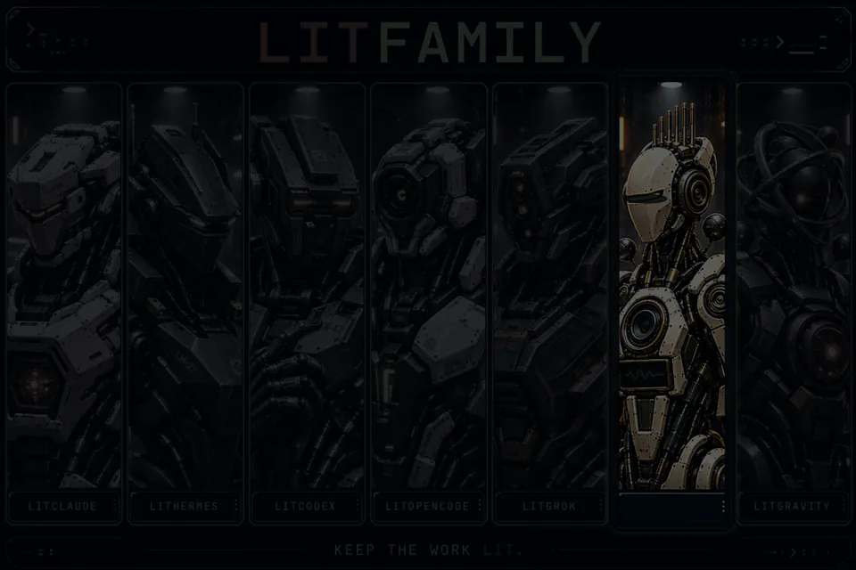</picture></p>

<h1 align="center">LitMuse</h1>
<p align="center"><strong>Keep the work lit.</strong></p>

<p align="center">LitMuse gives Meta's Muse Code the habit of planning before it edits, checking what it built, and leaving a handoff, so the next session starts where this one stopped. One npm command installs it as a Muse plugin.</p>

<p align="center">
<a href="https://www.npmjs.com/package/@litfamily/litmuse"></a>
<a href="./LICENSE"></a>
<a href="https://github.com/wjgoarxiv/litmuse/stargazers"></a>
</p>

<p align="center"><a href="#inside-one-lit-turn">How it works</a> &nbsp; <a href="#in-the-muse-app-too">Muse app</a> &nbsp; <a href="#install">Install</a> &nbsp; <a href="#quick-start">Quick start</a> &nbsp; <a href="#the-status-card">Status card</a> &nbsp; <a href="#automatic-handoff">Handoff</a> &nbsp; <a href="#safety">Safety</a> &nbsp; <a href="./README_ko-KR.md">한국어</a></p>

> [!TIP]
> One `npx` line installs LitMuse as a Muse plugin; then open Muse and start a prompt with `lit`, for example
> `lit plan a tiny todo app`. [Quick start](#quick-start) has the lines.

## Pick your path

| I want to… | Do this | Go to |
| --- | --- | --- |
| Try it now | Install, check, type `lit plan` | [Quick start](#quick-start) |
| Know what the installer writes | Read the four install steps | [Install](#install) |
| See what one `lit` prompt does | Follow the route and the plant | [Inside one lit turn](#inside-one-lit-turn) |
| Make decks, documents or figures | Add extensions from wjgoarxiv-skills | [Extensions](#extensions) |
| See what is running | Open the status card | [The status card](#the-status-card) |
| Update or remove LitMuse | Rerun install, or uninstall | [Update and uninstall](#update-and-uninstall) |
| Look up hooks, safety, the rules-file block | Read the reference | [Reference](#reference) |

## Quick start

You need Node.js 20 or newer and Muse Code, signed in once.

1. Run the two lines below. The installer shows every destination first, then asks once whether to approve the hooks and agents.
2. `doctor` ends with `LitMuse doctor: PASS` when everything is in place.
3. Open Muse in a project with `muse`. `/skills` shows the LitMuse skills and `/plugins` the plugin.
4. Start a prompt with `lit`. Plain `lit` runs lit-loop; a word after it picks the route: `lit plan`, `lit review`, `lit research`, `lit debug`, `lit handoff`, `lit recap`, `lit korean`.
5. Approve a plan, then type `/start-work` to build it row by row with tests. Before you stop, `lit handoff`; next time, `lit recap` reads where you were.

Run from any folder:

```bash
npx @litfamily/litmuse install
npx @litfamily/litmuse doctor
```

Stripped to three lines, a planning session goes like this:

```text
you type    lit plan a tiny todo app
it does     loads lit-plan, reads the repo, writes plans/todo-app.md with ordered rows
it ends     "Plan saved. Run /start-work when you are happy with it."
```

<p align="center">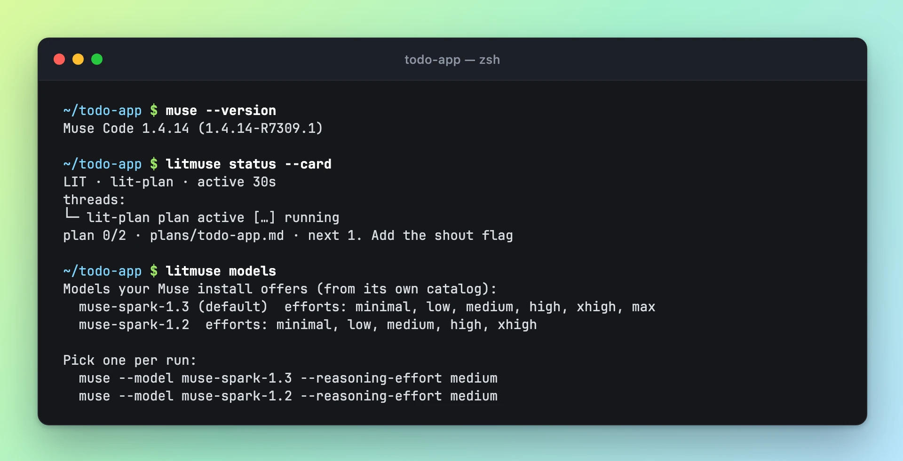</p>

Headless runs work the same way: `muse exec --json "lit plan a tiny todo app" < /dev/null`.

## What you can make

Four real outputs rendered on a Mac during the quality parity round, each opened, read, and fixed until it looked right. The deck, the P&ID and the page came from skills that are now LitFamily extensions; [Extensions](#extensions) says how to add them alongside LitMuse.

<p align="center">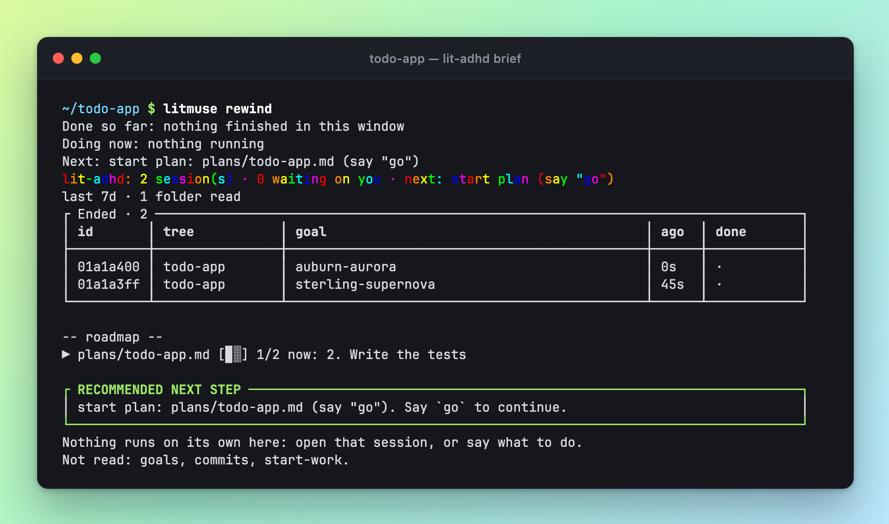</p>

`lit-adhd` opens with a KPI board: the one thing to do now and the exact text to type, done / in progress / waiting on you / left counts with an overall bar, and milestone rows with ten-cell bars. It also lists what you finished lately, what is still to do, and reminders such as uncommitted changes or a plan untouched for a week. `lit adhd detail` adds the per-session brief pictured above: session cards with status badges, an ended table and a boxed recommended step, in colour on a TTY with no internal field names leaking.

<p align="center">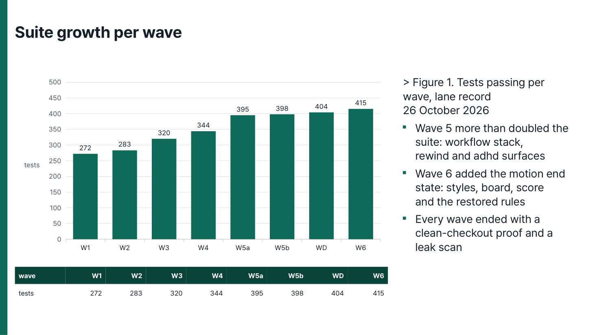</p>

`lit-pptx` compiles real decks from data: this one charts the port's own test-suite growth, wave by wave.

<p align="center">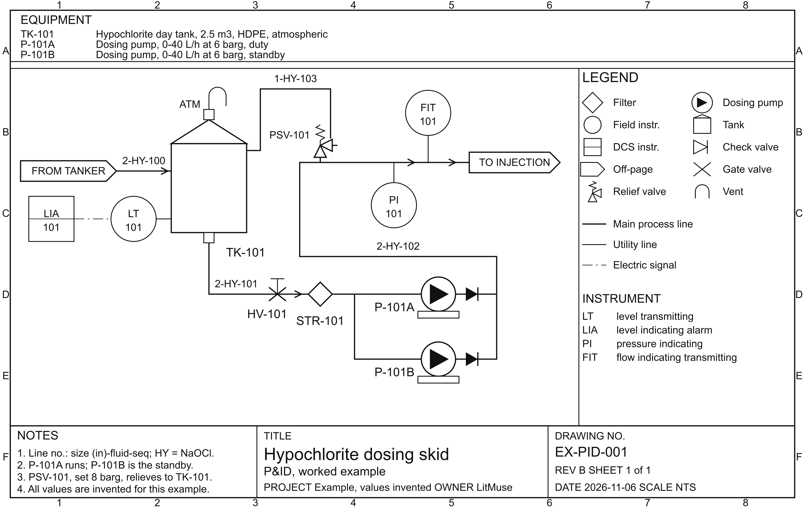</p>

`lit-schematic` draws QA-checked P&IDs: a dosing skid with real symbols, a drawn legend, line numbers and a title block, after seven look rounds until every label read cleanly.

<p align="center">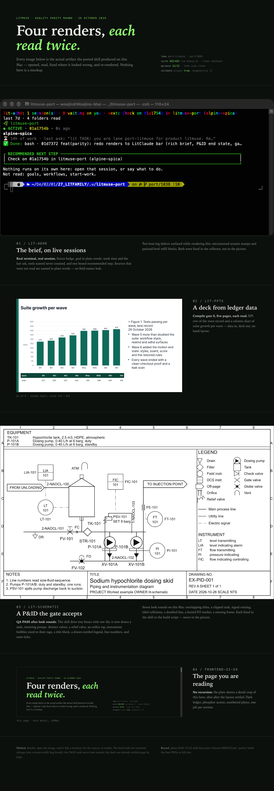</p>

`frontend-ui-ux` builds the page around them: one gallery, one plate per render, checked at phone, tablet, and desktop widths.

## What you get

Muse still runs the session and picks the model; LitMuse adds the way of working around it, kept in plain files you can read. It suits people who run Muse Code on real projects and want proof before done and sessions that pick up where the last one stopped. It helps most on work longer than one sitting (a feature with tests, a refactor, a research question), and it also cleans up stiff Korean or English prose and, with [extensions](#extensions), builds slides and Word reports.

| The host | What lit adds |
| --- | --- |
| Takes a line and gets to work | Pins the goal and writes the failing test first |
| Fills its context over a long session | Writes the handoff before compaction, reads it back after |
| Opens the next session blank | `lit recap` reads the handoff and names the next step |
| Calls it done when the model says so | Checks the plan with tests and real-surface proof |

**33 skills** load on demand, each a dense Muse skill with the references and scripts it needs inside its own folder. The catalog holds only their short descriptions, so they keep their place even next to a large personal skill collection. Nine short stubs stand in for the skills that became LitFamily extensions (see [Extensions](#extensions)).

| Area | Skills | Role |
| --- | --- | --- |
| Work loop | lit-loop, litgoal, litwork | Goal pinned, failing test first, record left |
| Plan and build | lit-plan, start-work, lit-code, debugging, refactor, lit-commit, lsp, lsp-setup | Written plan, then row-by-row build |
| Ideas first | lit-brainstorm, deep-interview, lit-crucible | Diverge, clarify, pressure-test |
| Review and cleanup | review-work, comment-checker, lit-burnoff, lit-burnoff-file | Second look, then residue stripped |
| Research | litresearch, autoresearch, autoconference, wikify, lit-comprehend | Parallel searchers, traced claims |
| Teams | lit-team | Child agents behind one packet |
| Prose | lit-humanizer | Korean and English cleanup, facts kept |
| Continuity | lit-recap, lit-handoff, lit-init, rules | Handoffs, recaps, orientation |
| Tools | structural-search, browser-drive | Syntax-shaped search, live pages |

The skills call programs already on your machine: Python 3.10 to 3.14 for autoresearch (a newer `python3` is passed over for the newest `python3.X` in that range), Chrome or Chromium for browser-drive, ast-grep and the language checkers the `lsp` skill drives. `doctor` lists what is missing and the command that installs it; LitMuse installs nothing globally.

| Part | What it is |
| --- | --- |
| **4 commands** | `/lit <route> <task>`, `/lit-korean <file or text>`, `/lit-status`, `/lit-hud` |
| **10 hooks** | Routing, plan limits, the ledger, handoffs and the live card ([each hook](./docs/reference.md#hooks)) |
| **11 agents** | Spawned as `litmuse/<name>` (list below) |
| **Models** | `npx @litfamily/litmuse models` reads them from Muse's own catalog |

The agents are lit-planner, lit-executor, lit-verifier, qa-runner, quality-reviewer, librarian-researcher and five Korean prose agents; reviewers and the Korean agents get read and search tools only. `models` lists the models and effort tiers your Muse install offers, so a model Meta adds later shows up there with no LitMuse update.

## Install

The [Quick start](#quick-start) line installs LitMuse at user scope, so it is available in every project. The picture follows one install from left to right: the top row is what the installer does, and the row under it is where each step writes.

<p align="center">
  <picture>
    <source media="(prefers-color-scheme: dark)" srcset="./docs/assets/diagrams/install-approve.en.dark.png">
    / alone and never reads Muse's credential file. It writes ~/.config/muse/AGENTS.md only inside its marked block, after asking once; config agentFile off removes it.">
  </picture>
</p>

1. **Preview** shows every destination and writes nothing; `--dry-run` stops here.
2. **Stage** backs up the Muse files it is about to change and copies the plugin to `~/.local/share/litmuse/bundle`, LitMuse's own folder.
3. **Install in Muse** runs `muse plugins install` at user scope, and the `muse` CLI records the plugin in Muse's plugin store. Skills and commands work right away.
4. **Approve** covers the 21 capabilities (10 hooks, 11 agents) that Muse runs only after you approve them. The installer asks you once whether to approve them all and keeps your yes in Muse's settings; say no and it prints the `muse plugins approve ...` lines for later.

The bottom row of the picture covers why an update may ask again, what install leaves alone, and the one file it writes only after you agree ([the rules-file block](./docs/reference.md#a-short-block-in-muses-own-rules-file)). Muse re-arms the agent approvals whenever the plugin is updated, so after an update the installer asks once more for those. In `doctor`, each capability that still waits for approval appears as `APPROVAL NEEDED` together with the exact command.

<details>
<summary>Install switches</summary>

- **`--dry-run`** previews and writes nothing.
- **`--yes`** lets an agent or CI shell install; a shell without a terminal otherwise only previews.
- **`--approve`** approves the capabilities without the question, for scripts.
- **`--scope project`** installs for one project.

</details>

<details>
<summary>Let a coding agent install it</summary>

Paste this into a coding agent opened in any folder:

```text
Install LitMuse, the LitFamily plugin for Meta's Muse Code.
Use only the official npm package @litfamily/litmuse. Show me your plan and wait for my yes before changing anything.
1. Check that Node.js 20+ and muse are on PATH (`muse --version`).
2. Preview: npx @litfamily/litmuse install --dry-run
3. Install: npx @litfamily/litmuse install --yes
   This installs the plugin and prints 21 approval commands. Ask me before approving; on my yes run
   npx @litfamily/litmuse install --yes --approve
4. Verify: npx @litfamily/litmuse doctor and report its last line.
5. Tell me what was written (the installer prints a "Written:" list) and anything it refused.
```

</details>

## Features

### The status card

Muse's `/hud` is a fixed list of on/off fields, so plugins add nothing to it. LitMuse keeps its own live record of the route, the plan progress and the child agents running right now, and `/lit-status` and `litmuse status --card` show it. The recommended `/hud` and theme preset for the terminal chrome around the card lives in [docs/hud-preset.md](./docs/hud-preset.md).

Read the card from top to bottom. The first line names the workflow and how long it has run, or says no route is active in this workspace; a second line names the plan file with ticked and total rows and the next open row. A lanes line names each running tool with its elapsed time, then each finished lane.

At rest the card reports no active route:

<p align="center">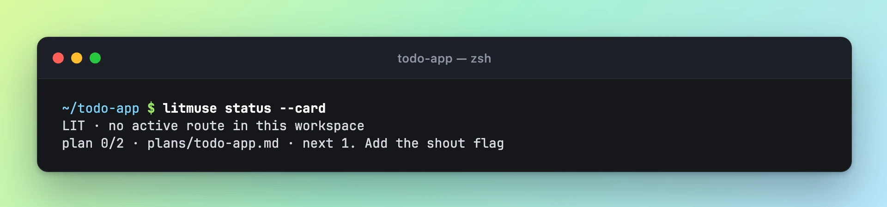</p>

While a plan runs, the card names the route, the plan file, and the next open row:

<p align="center"></p>

Ticking a row moves the count and the next-row pointer:

<p align="center">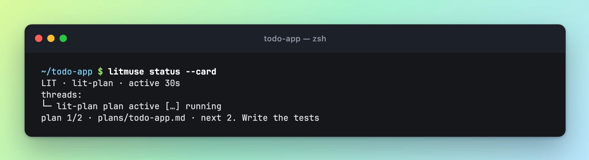</p>

The card reads the hook-kept state under `~/.local/state/litmuse/`, outside the project. How it lists other sessions is in [the reference](./docs/reference.md#the-live-record-behind-the-card).

### Automatic handoff

A long session fills the model's context, and when Muse compacts it, detail drops out of the summary. So the PreCompact hook writes a handoff file before the compaction, and SessionStart reads the fresh file back into the conversation after it. Type `lit handoff` before you stop and `lit recap` when you return; the packet names what was built, how it was checked, and what is left.

The hook answers with one recorded line:

<p align="center">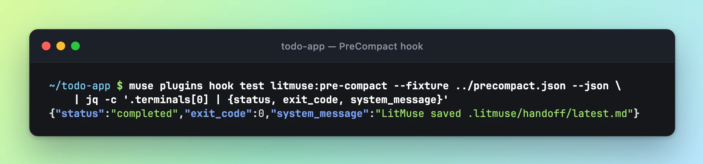</p>

The snapshot names the trigger, the session, the route, the plan with its open rows, and recent ledger lines:

<p align="center">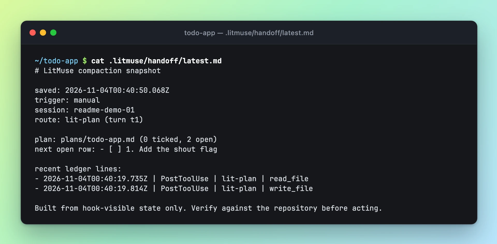</p>

### In the Muse app too

Meta ships two Muse products: Muse Code is the terminal agent this README is about, and the Muse app is the desktop agent with a chat window, side chats, notes and tasks. LitFamily also works inside the Muse app. Its lit skills load there the same way, and a reply opens with the same ignition mark you see in the terminal.

The capture is one new side chat that asks `/lit-brainstorm` for names for a small open-source note tool you use from the terminal. The answer opens with `🔥 LIT IGNITED · lit-brainstorm 🔥` and sets weighted criteria before scoring. It first drops the names that are already taken (`jot`, `memo`, `mnemo`, `scratch`, `margin`), then shows a scored table of the top ten.

<p align="center"></p>

### Extensions

LitMuse's core is complete and works on its own: planning, building, review, research, handoffs and the rest of the skills table need nothing else. The nine skills that make files (decks, documents, figures, design and video covers) are LitFamily extensions on the extension shelf, [wjgoarxiv-skills](https://github.com/wjgoarxiv/wjgoarxiv-skills); install the ones you use alongside LitMuse to get the full LitFamily experience. The installer says this when you install or update, and the first Muse session after it says it once more.

The picture puts the core on the left, which ships with LitMuse, beside nine stubs that keep their ids and `lit` routes and each point to their Muse edition on the shelf. The row below is one install in four steps: check every folder Muse reads for the same name, move an occupied folder aside, copy the edition into Muse's user skills, and let Muse record it in its lock.

<p align="center">
  <picture>
    <source media="(prefers-color-scheme: dark)" srcset="./docs/assets/diagrams/core-extensions.en.dark.png">
    /. Installing one is four steps: check every folder Muse reads for the same name and stop on one; move an occupied folder whole into extension-backups/<stamp>/; muse skills install <clone>/variants/litmuse/<id> --scope user copies the edition into ~/.config/muse/skills/<id>/; Muse records source, time and file hashes in skills/.muse/lock.json. npx @litfamily/litmuse extensions (list, check, install, update, remove, prune-backups) runs those steps and shows only its plan until --yes. LitMuse install and update leave the copy alone. When a lit route reaches a stub, Muse loads the installed copy, or the stub shows the install line.">
  </picture>
</p>

Each stub keeps the id, its `lit` routes and its catalog entry, and either hands over to your installed copy or tells you how to install it. It never builds a stand-in.

| Family | Skills |
| --- | --- |
| `decks` | lit-pptx |
| `documents` | lit-docx |
| `figures` | lit-diagram-drawer, lit-schematic, lit-scientific-visualization |
| `design` | frontend-ui-ux, visual-qa |
| `video-covers` | lit-typographic-motion, readme-studio |

**Install one extension.** Clone the shelf once, then install each extension on its own into Muse's user skills, from the Muse edition that wjgoarxiv-skills keeps for it. You can type the steps yourself or let `extensions install` run them (below).

```bash
git clone https://github.com/wjgoarxiv/wjgoarxiv-skills
```

Then, for each extension, run three lines from the project you work in, with `<skill>` replaced by its id:

- **Line 1** only reads: it prints each folder Muse could load under that id (your Muse user skills, the personal `~/.claude/skills` and `~/.codex/skills` that Muse also loads, and the project's `.agents/skills` and `.claude/skills`).
- **Line 2** moves an existing copy in Muse's user skills, whole and with any file you added, into a dated folder under `extension-backups/` beside them, where Muse does not look; with nothing there it does nothing.
- **Line 3** installs.

```bash
command ls -d "${XDG_CONFIG_HOME:-$HOME/.config}/muse/skills/<skill>" "$HOME/.claude/skills/<skill>" "$HOME/.codex/skills/<skill>" .agents/skills/<skill> .claude/skills/<skill> 2>/dev/null
D="${XDG_CONFIG_HOME:-$HOME/.config}/muse/skills/<skill>"; B="${XDG_CONFIG_HOME:-$HOME/.config}/muse/extension-backups/$(date +%Y%m%d-%H%M%S)"; [ -e "$D" ] && mkdir -p "$B" && mv "$D" "$B/" && echo "moved to $B/<skill>"
muse skills install <path to your wjgoarxiv-skills clone>/variants/litmuse/<skill> --scope user
```

To update, run the three lines again. To remove one, run the second line and then `muse skills uninstall <skill>`, which then only drops Muse's record of it. LitMuse's installer, its updates and its uninstaller never write that folder, so upgrading LitMuse keeps your copy where it is.

<details>
<summary>What a Muse edition is, and how Muse ranks the copies</summary>

- **Self-contained.** A Muse edition is the skill rewritten to stand alone in Muse: it carries its own helpers, fonts and lockfiles and uses Muse's tools. It sets up any engine it needs (the office runtime, the diagram renderer, matplotlib, the motion engine) on first use from the installed folder, so it needs no LitMuse hook, approval or runtime command.
- **Same id.** The next session lists the copy as a user skill under the same id; `lit` routes then load it, and `doctor` reports it as `INFO moved` rather than an overlap.
- **Where it lives.** The copy lives in `$CONFIG_DIR/skills/<skill>/`, which LitMuse's installer, its updates and its uninstaller never write or remove.
- **Muse's lock.** Muse records each install in its own lock (`$CONFIG_DIR/skills/.muse/lock.json`: source folder, time, file hashes) and refuses to install over a folder that is already there, which is why the second line comes first.
- **Ranking.** A personal copy in `~/.claude/skills` or `~/.codex/skills` ranks below the user skill and shows as shadowed; a project copy in `.agents/skills` or `.claude/skills` ranks above it inside that project.
- **Updating.** Leave out `--force` and `muse skills update`: both rewrite the shipped files in place and keep every other file, so anything a newer edition dropped would stay behind.

</details>

**Let LitMuse run the lines.** `npx @litfamily/litmuse extensions install <skill>` runs the same steps and keeps Muse's lock as the receipt. Every verb that writes first prints its plan and changes nothing until you add `--yes`.

<details>
<summary>The <code>extensions</code> verbs and what each one checks</summary>

`install` looks first, stops and names any same-name skill in another folder Muse reads (it never touches that one; `--allow-shadow` installs anyway and only warns), moves an occupied folder aside into a dated `extension-backups/` folder, and then calls `muse skills install`. It takes several ids, `--family <name>` or `--all`. `--from <clone>` uses your own clone; without it LitMuse keeps a shallow clone of only `variants/litmuse` in `~/.cache/litmuse/extensions-src` and refreshes it on each run, and when git or the network is missing it stops before changing anything and suggests `--from`.

| Verb | What it does |
| --- | --- |
| `list` | Each extension: not installed, installed (source, time), user-managed, same-name copies |
| `check` | What needs a look, each with the line that fixes it |
| `update` | Reinstalls only the extensions whose files changed on the shelf |
| `remove` | Moves the folder into the backups, then runs `muse skills uninstall` |
| `prune-backups` | Deletes only dated folders inside `extension-backups/` |

```bash
npx @litfamily/litmuse extensions list
npx @litfamily/litmuse extensions check
npx @litfamily/litmuse extensions install lit-docx --yes
npx @litfamily/litmuse extensions update --yes
npx @litfamily/litmuse extensions remove lit-docx --yes
npx @litfamily/litmuse extensions prune-backups --older-than 30 --yes
```

`remove` refuses a folder Muse has no record of, or one installed from somewhere other than a wjgoarxiv-skills edition, and names its path. `prune-backups` is the only verb that deletes. `doctor` runs the same check and prints one line, and the installer adds a line pointing at `extensions check` when it finds something; nothing changes on its own.

</details>

## Inside one lit turn

A prompt that starts with `lit` goes through four steps, and each one leaves something you can open later. The bottom row shows where all of this ends up: three of the four live in your project, and the route state sits in your home folder, where a planning turn cannot reach it.

<p align="center">
  <picture>
    <source media="(prefers-color-scheme: dark)" srcset="./docs/assets/diagrams/lit-route.en.dark.png">
    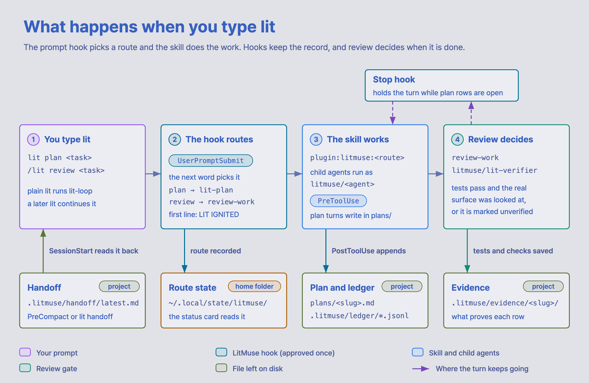 works, child agents run as litmuse/<agent>, and PreToolUse keeps plan turns in plans/. 4, review-work and litmuse/lit-verifier decide; a Stop hook above holds the turn while plan rows are open. Below, the files each step leaves: .litmuse/handoff/latest.md, which SessionStart reads back; route state in ~/.local/state/litmuse/; plans/<slug>.md and .litmuse/ledger/*.jsonl, appended by PostToolUse; and .litmuse/evidence/<slug>/.">
  </picture>
</p>

<details>
<summary>The four steps, one by one</summary>

1. **Route.** The prompt hook reads the word after `lit` and picks the route. `lit plan` goes to lit-plan, plain `lit` goes to lit-loop, and another `lit` while that route is still running carries it on.
2. **Load.** Muse loads the route's skill, which may hand parts of the work to child agents such as `litmuse/lit-verifier`.
3. **Work.** During a planning turn the PreToolUse hook lets writes land only under `plans/` and `.litmuse/`.
4. **Review.** The work counts as done when the tests pass and someone looked at the real surface; anything nobody could check is marked unverified. While plan rows are still open, the Stop hook keeps the turn going.

</details>

Here is the same turn drawn as a small process plant. A prompt comes in on the left, the route check sends it to the plan unit or straight to the build unit, and checked work leaves on the right with its evidence. The stream table says which file each stream becomes.

<p align="center">
  <picture>
    <source media="(prefers-reduced-motion: reduce) and (prefers-color-scheme: dark)" srcset="./docs/assets/schematic/lit-plant.en.dark.png">
    <source media="(prefers-reduced-motion: reduce)" srcset="./docs/assets/schematic/lit-plant.en.light.png">
    <source media="(prefers-color-scheme: dark)" srcset="./docs/assets/schematic/lit-plant-loop.en.dark.webp">
    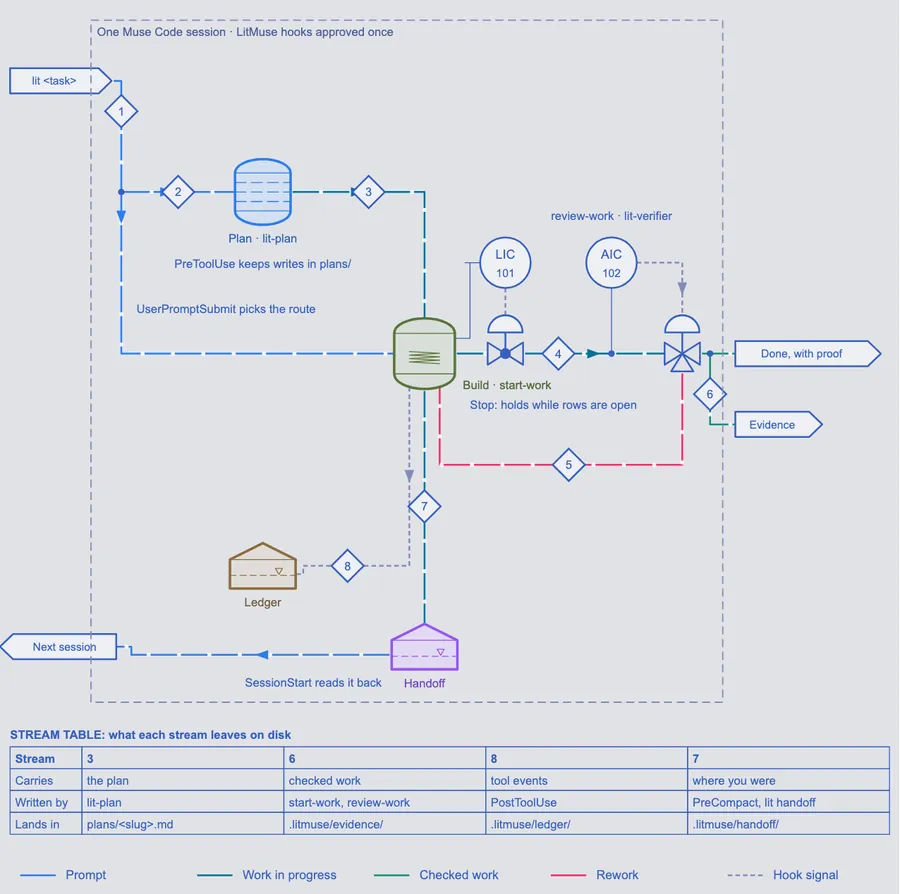 prompt enters on the left; UserPromptSubmit picks the route, sending lit plan to the plan unit (lit-plan, PreToolUse keeps writes in plans/) and plain lit to the build unit (start-work). The plan file flows into the build unit. Its outlet valve is held by a level controller labelled Stop: holds while rows are open. The draft passes an analyser for review-work and lit-verifier, whose diverter sends checked work out as Done, with proof and Evidence, or back to the build unit as rework. Below, a hook signal fills the ledger tank and the handoff tank feeds the next session, which SessionStart reads back. A stream table lists what each stream leaves on disk: plans/<slug>.md, .litmuse/evidence/, .litmuse/ledger/ and .litmuse/handoff/.">
  </picture>
</p>

<details>
<summary>Reading the plant</summary>

Work leaves the build unit through a valve that the Stop hook keeps shut while plan rows are open, then passes the review analyser. Anything that fails review goes back to be built again. Underneath, the hooks fill two tanks: the ledger of tool events, and the handoff that the next session reads back.

</details>

### What a planning turn may do

`lit plan` turns are planning only, and the PreToolUse hook holds that line with an allowlist. Anything unlisted is refused, including MCP tools and tools a later Muse release adds. If the route state goes missing or breaks during a plan turn, the limit stays on.

<details>
<summary>The allowlist, tool by tool</summary>

- **Read-only tools:** `read_file`, `search`, `read_skill`, `web_search`, `web_fetch`, `read_memory`, `work_status`, `work_list`, `subagent_status`, `subagent_wait`, `subagent_read_result`, `subagent_cancel`, `request_user_input`, `get_goal`, `cron_list`.
- **File writes** (`write_file`, `edit_file`, `apply_patch`, `delete_file`) only inside `plans/` and `.litmuse/`, after `..` and symlinks are resolved.
- **Shell** (`bash`, `exec_command`, `shell`) only for one plain command from `ls`, `cat`, `head`, `tail`, `wc`, `rg` or `git log|status|diff|show`, with listed flags and no `;`, `&`, `|`, `<`, `>`, backticks, `$` or line breaks. `bash_input` is refused.
- **Child agents** only as read-only `litmuse/*` agents (lit-planner, librarian-researcher, lit-verifier, quality-reviewer and the Korean prose agents).

Route state lives outside the project, under `~/.local/state/litmuse/`, so no tool in a planning turn reaches it. Each hook's declared command carries a digest of its code, so when an update changes a hook, Muse asks you to approve it again.

</details>

## Update and uninstall

To update, run the install line again. To remove everything, run `uninstall` (add `--dry-run` to preview); it takes the rules-file block out too, and plans and `.litmuse/` folders in your projects stay where they are.

| Task | Command |
| --- | --- |
| Install | `npx @litfamily/litmuse install` |
| Preview first | `npx @litfamily/litmuse install --dry-run` |
| Update | `npx @litfamily/litmuse install` |
| Check | `npx @litfamily/litmuse doctor` |
| Remove | `npx @litfamily/litmuse uninstall` |

## Troubleshooting

**Muse also loads my personal rules and skills from other tools.** Muse reads personal rules and skills written for other coding tools, such as a user rules file or a personal skills folder, and LitMuse leaves that on because those rules are yours. Its session context asks Muse to use the LitMuse skill for every lit route.

**`doctor` warns about a personal skill.** It shares a name with a LitMuse skill or comes from another tool's plugin folder. For a clean run, switch off "Personal rules fallback" and "Personal skills fallback" in `/settings`; a headless run takes `muse exec --no-foreign-personal-context` (the interactive `muse` rejects that flag on 1.4.11).

**`doctor` shows `INFO leftover`.** LitMuse ships no engine runtime any more; releases up to 0.1.11 cached them under `~/.local/share/litmuse/runtime/`, and `uninstall` never removed that folder. Nothing reads it now (an extension sets up its own engines), so delete it to free the space.

## Reference

[docs/reference.md](./docs/reference.md) holds what a first install does not need: [every hook](./docs/reference.md#hooks), [the live record behind the card](./docs/reference.md#the-live-record-behind-the-card), and [the short block in Muse's own rules file](./docs/reference.md#a-short-block-in-muses-own-rules-file).

### Safety

The installer writes to `~/.local/share/litmuse/` and, through the `muse` CLI, to Muse's own plugin store and settings, and it writes nothing under `~/.claude` or `~/.codex`. Hooks fail open: if one breaks, your session continues.

<details>
<summary>Everything the installer and <code>extensions</code> write, back up and refuse</summary>

- **Backups first.** The installer backs up `~/.config/muse/settings.json` and Muse's `installed.json` first, and it reads Muse's credential file in no step. The one file it edits outside those is Muse's user rules file, and only inside its own marked block ([details](./docs/reference.md#a-short-block-in-muses-own-rules-file)).
- **Refusals.** It refuses to replace a bundle directory that is a symbolic link, holds someone else's files, or was edited after install.
- **Pinned by a test.** It writes nothing under `~/.claude` or `~/.codex`; a test pins that.
- **`extensions`** writes only when you add `--yes`, and then only three places: Muse's user skills (through `muse skills install` and `uninstall`), `~/.config/muse/extension-backups/`, and its own clone in `~/.cache/litmuse/extensions-src`. A linked folder in any of them stops it before the first change.

</details>

## Family

LitMuse is one of the seven LitFamily packages, and the seven armored robots on the cover stand for them. Each package brings the same way of working to one coding agent and installs and runs on its own, so you only need the one for the agent you use.

## License

MIT, © LitMuse contributors. LitMuse is an independent community project and is not affiliated with or endorsed by Meta.

The LitMuse and LitFamily names, logos and mascot art are covered by [TRADEMARK.md](./TRADEMARK.md).
